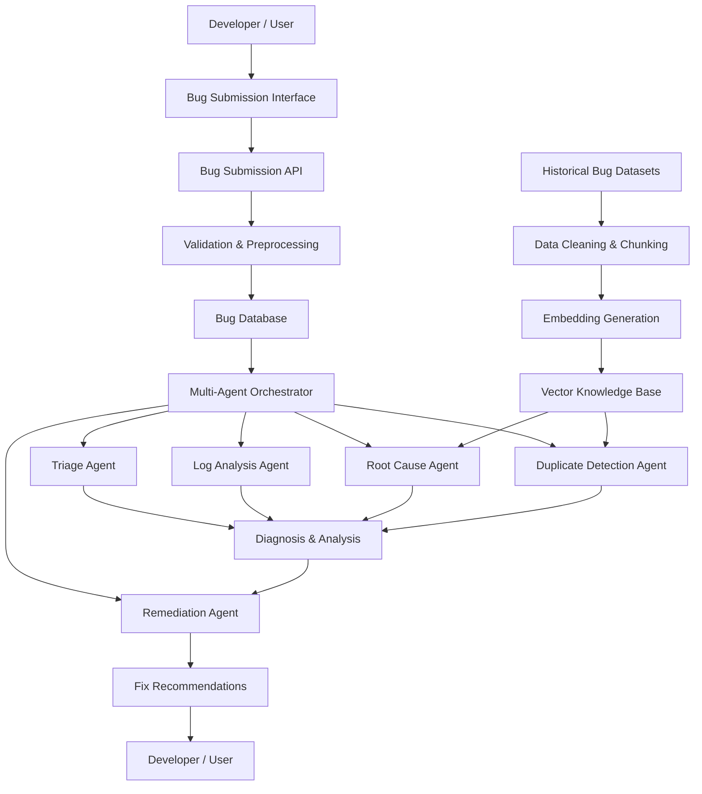
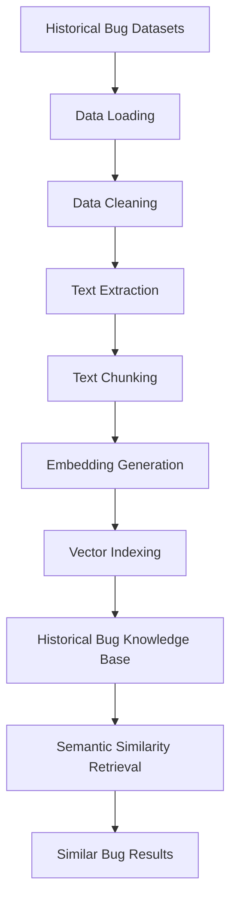

# 🐞 Intelligent Bug Diagnosis Platform with Fix Recommendation Assistance

**Infosys Springboard Virtual Internship Program**

An intelligent, AI-powered software debugging platform designed to automate bug understanding, historical defect analysis, root cause identification, and fix recommendation using Retrieval-Augmented Generation (RAG), semantic similarity, and multi-agent architecture.

---

## 📌 Project Overview

Software debugging is a time-consuming process that requires developers to manually examine bug reports, stack traces, application logs, and historical defect records.

The **Intelligent Bug Diagnosis Platform with Fix Recommendation Assistance** aims to simplify this process by providing an intelligent system that analyzes submitted bug reports, retrieves similar historical defects, identifies potential root causes, and recommends appropriate solutions.

The platform combines Natural Language Processing (NLP), Machine Learning, Retrieval-Augmented Generation (RAG), and a multi-agent architecture to improve the efficiency and accuracy of software debugging.

### 🎯 Objectives

- Automate the initial analysis and classification of software bugs.
- Accept bug reports through direct text submission and file uploads.
- Build a historical defect knowledge base using publicly available bug datasets.
- Apply semantic similarity and vector-based retrieval to identify related bugs.
- Analyze stack traces, error logs, and bug descriptions.
- Identify potential root causes of software defects.
- Generate intelligent fix recommendations.
- Reduce manual debugging effort and improve developer productivity.

---

## 🏗️ System Architecture

The platform follows a modular, multi-agent architecture with a centralized orchestration layer and a Retrieval-Augmented Generation (RAG) knowledge base.

### High-Level Architecture



### Architecture Components

| Component | Responsibility |
|---|---|
| User Interface | Accepts bug reports and displays results |
| Bug Submission API | Handles bug submission and retrieval |
| Validation Module | Validates and processes submitted information |
| Bug Database | Stores bug reports and metadata |
| Multi-Agent Orchestrator | Coordinates the five specialized agents |
| Historical Knowledge Base | Stores historical software defect information |
| Embedding Engine | Converts textual bug information into numerical vectors |
| Retrieval Engine | Finds semantically similar historical defects |
| Diagnosis Engine | Supports root cause analysis |
| Recommendation Engine | Generates possible bug fixes |

### Five Specialized AI Agents

**1. Triage Agent**

- Examines incoming bug reports.
- Identifies bug categories and severity.
- Organizes bugs for further analysis.

**2. Log Analysis Agent**

- Examines application logs and stack traces.
- Identifies exceptions, error patterns, and relevant log information.
- Extracts useful debugging evidence.

**3. Root Cause Agent**

- Analyzes the submitted bug and retrieved historical defects.
- Identifies potential causes of the issue.
- Provides supporting diagnostic information.

**4. Duplicate Detection Agent**

- Searches the historical defect knowledge base.
- Uses semantic similarity to identify duplicate or related bug reports.
- Helps avoid repeated investigation of known issues.

**5. Remediation Agent**

- Uses diagnosis results and historical solutions.
- Generates possible corrective actions.
- Provides fix recommendations to developers.


## 🛠️ Technology Stack

| Technology | Purpose |
|---|---|
| Python | Core backend development |
| FastAPI | REST API development |
| Pydantic | Request validation and data schemas |
| Sentence Transformers | Semantic embedding generation |
| PyTorch | Supporting embedding model execution |
| Pandas | Historical dataset processing |
| NumPy | Numerical and vector operations |
| RAG | Historical knowledge retrieval architecture |
| Vector Similarity Search | Identifying related historical defects |
| SQLite / Database Layer | Structured bug and knowledge-base storage, subject to configured database engine |
| Git & GitHub | Version control and project management |
| VS Code | Development environment |

### Core AI/ML Concepts

- Natural Language Processing (NLP)
- Retrieval-Augmented Generation (RAG)
- Text Chunking
- Sentence Embeddings
- Semantic Similarity
- Vector Search
- Cosine Similarity
- Multi-Agent Systems

---

## 📂 Project Development – Milestone 1

**Milestone 1: Foundation & Bug Understanding**

Duration: November 6 – November 15, 2026

Milestone 1 focuses on understanding software defect analysis, designing the overall system architecture, developing the bug submission module, and creating the historical defect knowledge base.

### M1.1 – Research and Technology Understanding

Research activities include:

- Understanding software defect analysis workflows.
- Studying Retrieval-Augmented Generation (RAG) architecture.
- Understanding semantic similarity and sentence embeddings.
- Exploring vector search and retrieval pipelines.
- Studying publicly available Mozilla, Apache, and Eclipse bug report datasets.
- Identifying appropriate technologies and development approaches.

### M1.2 – System Architecture Design

Designed the overall platform architecture, including:

- Overall system architecture.
- Five specialized AI agents and their responsibilities.
- Multi-agent orchestration approach.
- Bug report database schema.
- Historical defect knowledge base schema.
- End-to-end information flow.
- Integration between bug submission, storage, and retrieval modules.

### M1.3 – Bug Submission Module

Developed the foundation for accepting and storing software bug reports.

**Key Features:**

- Submit bug reports through API requests.
- Accept structured bug information.
- Capture bug title and description.
- Store project name and programming language.
- Record severity information.
- Accept stack traces and error-related information.
- Generate unique bug IDs.
- Validate incoming request data.
- Store submitted bug reports in the database.
- Retrieve individual bug reports using their IDs.

**Implemented API Endpoints:**

| Method | Endpoint | Description |
|---|---|---|
| GET | `/` | Root endpoint |
| GET | `/api/health` | Backend health check |
| POST | `/api/bugs` | Submit a new bug |
| GET | `/api/bugs/{bug_id}` | Retrieve a submitted bug |

**Example Bug Submission:**

```json
{
  "title": "NullPointerException during user login",
  "project_name": "BugDiagnosisTest",
  "programming_language": "Java",
  "severity": "High",
  "description": "Application crashes with NullPointerException when a user submits the login form with valid credentials.",
  "stack_trace": "java.lang.NullPointerException..."
}
```

Example generated bug ID:

`BUG-1BFAFBB3`

### M1.4 – Historical Defect Knowledge Base

Developed the foundation of a historical bug knowledge base using publicly available software defect datasets.

**Data Sources:**

- Mozilla Bug Reports
- Apache Bug Reports
- Eclipse Bug Reports

**Knowledge Base Processing Pipeline:**



**Implemented Features:**

1. Loaded historical bug records from public datasets.
2. Cleaned and preprocessed bug descriptions and related information.
3. Extracted bug descriptions, comments, and stack traces.
4. Divided historical bug information into smaller text chunks.
5. Generated semantic embeddings using Sentence Transformers.
6. Prepared the embedding-based knowledge base.
7. Implemented the foundation for retrieving semantically similar bugs.

**Current Knowledge Base Processing Results:**

| Metric | Result |
|---|---:|
| Historical bug records | 100 |
| Total generated chunks | 664 |
| Description chunks | 117 |
| Comment chunks | 381 |
| Stack trace chunks | 166 |

These results demonstrate the initial preparation of the historical defect knowledge base.

---

## 🔄 Overall System Workflow

The intended end-to-end workflow is:

1. **Bug Submission:** Developer submits a bug report with relevant details, logs, or stack traces.
2. **Validation:** The backend validates the submitted information.
3. **Storage:** The bug report is stored with a unique identifier.
4. **Preprocessing:** Bug information is cleaned and converted into searchable text.
5. **Embedding Generation:** The text is converted into semantic vectors.
6. **Historical Retrieval:** The system searches the knowledge base for related defects.
7. **Bug Diagnosis:** Specialized agents analyze the bug and supporting evidence.
8. **Root Cause Identification:** The system identifies potential reasons for the failure.
9. **Fix Recommendation:** The remediation component suggests possible solutions.
10. **Result Presentation:** Diagnostic information and recommendations are presented to the developer.

---

## 📁 Project Structure

```text
BugDiagnosisPlatform/
│
├── backend/
│   ├── main.py
│   ├── app_database.py
│   ├── schemas.py
│   ├── retrieval.py
│   ├── chunking.py
│   ├── generate_embeddings.py
│   │
│   ├── [Bug submission and API modules]
│   ├── [Historical dataset files]
│   ├── [Generated embedding files]
│   ├── [Database files]
│   │
│   └── requirements.txt
│
├── README.md
│
└── .gitignore
```

*The structure above highlights the main backend components; additional files and directories depend on the current implementation.*

---


## 🧪 Testing and Validation

The following functionalities form the Milestone 1 testing scope:

- Backend server startup and health check.
- Bug report submission through the API.
- Unique bug ID generation.
- Request validation.
- Database insertion.
- Individual bug report retrieval.
- Historical bug dataset processing.
- Text chunk generation.
- Embedding generation.
- Semantic similarity retrieval.

---

## 🔮 Future Development

The following capabilities are planned for subsequent milestones:

- Complete multi-agent orchestration.
- Automated bug classification and triage.
- Advanced stack trace and log analysis.
- LLM-powered root cause analysis.
- Improved duplicate bug detection.
- Context-aware fix recommendation.
- Interactive frontend dashboard.
- Integration of all agents into a unified diagnosis workflow.
- End-to-end testing and evaluation.

---

## 💡 Expected Impact

The platform aims to:

- Reduce manual debugging effort.
- Improve identification of previously reported defects.
- Reuse knowledge from historical software bugs.
- Accelerate root cause investigation.
- Provide context-aware fix recommendations.
- Improve software development and maintenance productivity.

---

## 👩‍💻 Project Information

**Project Title:** Intelligent Bug Diagnosis Platform with Fix Recommendation Assistance

**Program:** Infosys Springboard Virtual Internship Program

**Milestone:** Milestone 1 – Foundation & Bug Understanding

**Domain:** Artificial Intelligence | Machine Learning | Software Engineering | NLP | RAG

**Primary Language:** Python

**Repository:** [Add your GitHub Repository Link]

---

**Built as part of the Infosys Springboard Virtual Internship Program.**